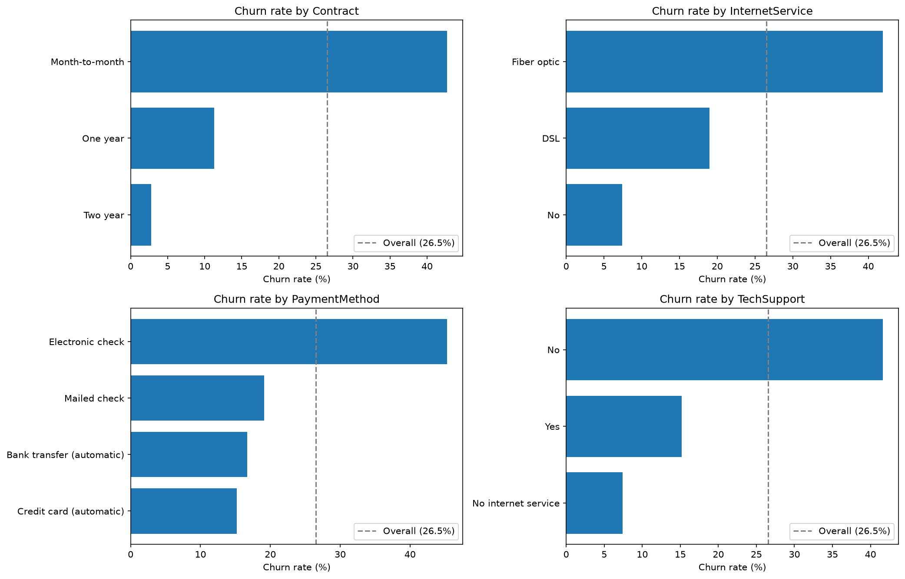
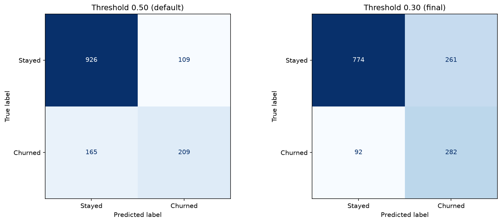
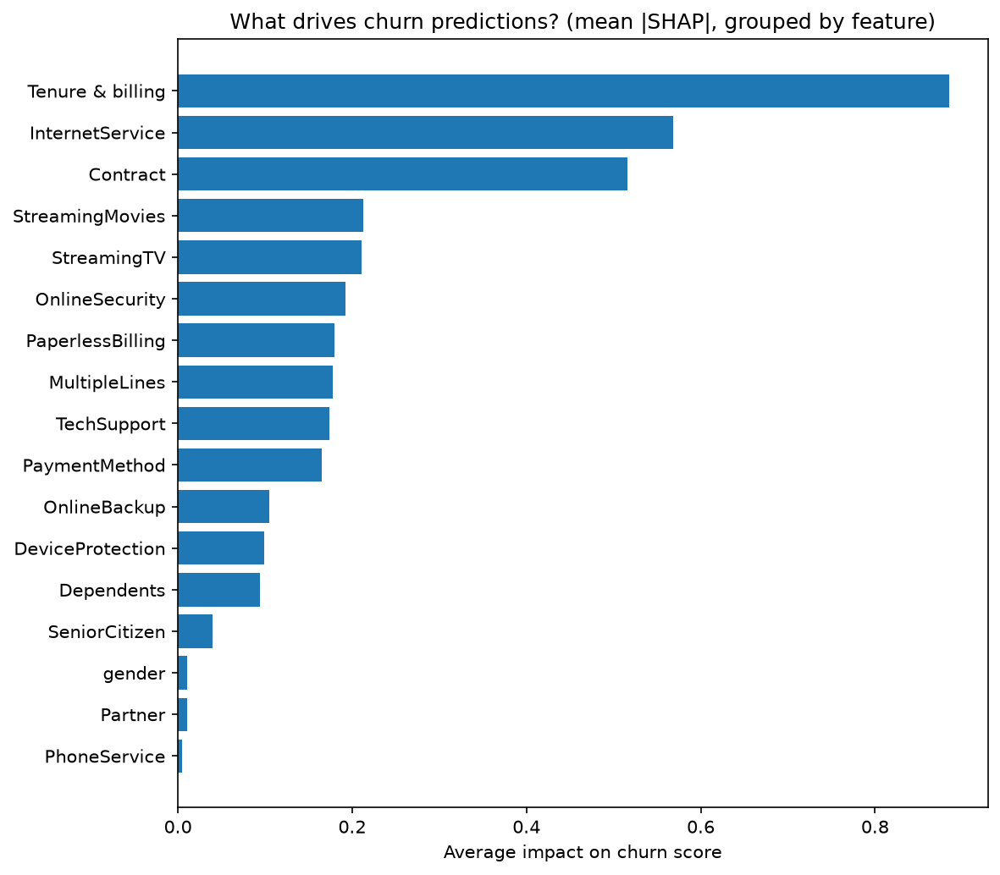
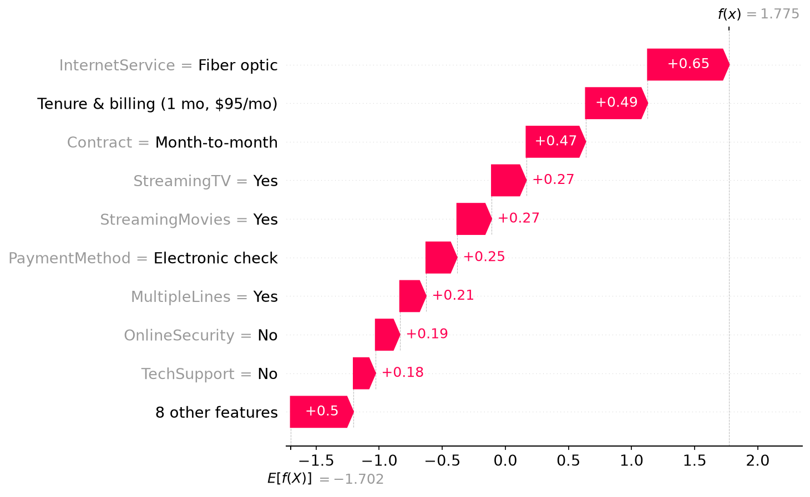
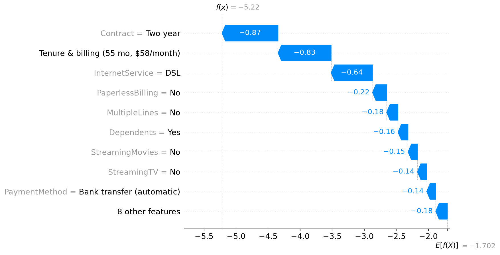

# Customer Churn Prediction with Explainable AI

Predicting which telecom customers are likely to cancel, explaining **why** with SHAP, and turning the predictions into a prioritized, costed retention plan.

**Highlights**

- Logistic Regression with a business-tuned threshold catches **75% of churners** on unseen customers (vs. 56% at the default 0.5 cutoff).
- SHAP shows churn risk is driven mainly by **short tenure, fiber-optic service, and month-to-month contracts**.
- The flagged 38% of customers carry **82% of expected revenue at risk**. A retention campaign targeting them **breaks even at a 4.9% success rate**.

---

## 1. Business Problem

A subscription telecom company is losing customers. The retention team has a limited budget and can't contact everyone, so it needs to know:

1. **Which** customers are most likely to churn?
2. **Why** are they likely to churn?
3. **What** actions could keep them, and are those actions worth the cost?

**Cost of errors.** A *false negative* (a churner the model misses) loses all of that customer's future revenue. A *false positive* (a loyal customer flagged as at-risk) costs only an unnecessary retention offer. Because these costs aren't symmetric, the project prioritizes **recall** while keeping precision acceptable, and chooses the classification threshold from business constraints rather than using the default 0.5.

---

## 2. Dataset

- **Source:** [IBM Telco Customer Churn](https://www.kaggle.com/datasets/blastchar/telco-customer-churn) (Kaggle). It's a sample dataset created by IBM, not a real company's records.
- **Size:** 7,043 customers × 21 columns: demographics, account information (tenure, contract, payment method, charges) and subscribed services.
- **Target:** `Churn` (Yes/No). Customers who left within the last month: **26.5%**.

**Data quality issue found:** `TotalCharges` was stored as text because **11 values were blank strings**, which a standard `isna()` check doesn't detect. All 11 belonged to customers with `tenure = 0` (not yet billed), so they were filled with **0** rather than dropped or imputed with a median, which would have given a brand-new customer roughly $1,400 of lifetime charges.

---

## 3. Tools

| Purpose | Tools |
| --- | --- |
| Data analysis | Python, pandas, NumPy |
| Visualization | matplotlib |
| Modeling | scikit-learn (Pipeline, ColumnTransformer, Logistic Regression, Random Forest, Gradient Boosting), XGBoost |
| Explainability | SHAP |
| Model persistence | joblib |
| Environment | Jupyter Notebook, Python 3.13, venv |

---

## 4. Workflow

1. **Business understanding:** defined churn, users of the model, and the cost of each type of error.
2. **Data understanding and cleaning:** checked types, missing values, duplicates, and hidden blank strings, then fixed `TotalCharges`.
3. **Exploratory analysis:** churn rates by contract, tenure, internet service, payment method, and tech support.
4. **Preprocessing:** stratified 80/20 train/test split, then scaling and one-hot encoding inside a `Pipeline` so preprocessing is learned from training data only (no leakage).
5. **Baseline model:** Logistic Regression.
6. **Model comparison:** four models compared with **5-fold stratified cross-validation** on the training set.
7. **Class imbalance:** compared class weighting with threshold tuning. SMOTE was deliberately not used (see below).
8. **Hyperparameter tuning:** `RandomizedSearchCV` (Gradient Boosting) and `GridSearchCV` (Logistic Regression).
9. **Final evaluation:** the test set was used **once**, after all modeling decisions were made.
10. **Explainability:** global and individual SHAP explanations.
11. **Risk segmentation:** four risk tiers sized by customers and revenue.
12. **Business impact:** campaign value under stated assumptions, with a sensitivity analysis.
13. **Final prediction table:** a ranked customer list with risk level and key churn drivers.

---

## 5. Key Findings from EDA

| Factor | Churn rate |
| --- | --- |
| **Contract:** Month-to-month vs. Two-year | **42.7%** vs. 2.8% |
| **Tenure:** first 12 months vs. 49–72 months | **47.4%** vs. 9.5% |
| **Internet:** Fiber optic vs. DSL vs. none | **41.9%** vs. 19.0% vs. 7.4% |
| **Payment:** Electronic check vs. automatic methods | **45.3%** vs. ~15–17% |
| **Tech support:** No vs. Yes | **41.6%** vs. 15.2% |

These factors overlap heavily: many short-tenure customers are also month-to-month, fiber, electronic-check customers. Single-variable charts can't separate their effects, which is why SHAP was used later.



---

## 6. Model Performance

### Model comparison (5-fold cross-validation, training set, threshold 0.5)

| Model | Accuracy | Precision | Recall | F1 | ROC-AUC (± std) |
| --- | ---: | ---: | ---: | ---: | ---: |
| Gradient Boosting | 0.804 | 0.663 | 0.529 | 0.588 | **0.848** ± 0.013 |
| **Logistic Regression** | 0.802 | 0.652 | 0.544 | 0.592 | **0.846** ± 0.013 |
| XGBoost | 0.784 | 0.612 | 0.515 | 0.559 | 0.825 ± 0.007 |
| Random Forest | 0.788 | 0.633 | 0.483 | 0.547 | 0.821 ± 0.012 |

### Why Logistic Regression was chosen

- After tuning, Gradient Boosting reached a CV ROC-AUC of **0.850** vs. **0.846** for Logistic Regression. The 0.004 gap is well within fold-to-fold noise (±0.013).
- With equal performance, the simpler model wins: it's transparent, fast, and easy to explain to stakeholders.
- Likely reasons the simple model kept up: churn is driven by direct, consistent effects (contract, tenure, internet type), most features are categorical (which one-hot encoding handles well), and the top five tuned Gradient Boosting configurations all scored 0.849–0.850, suggesting a ceiling set by the **data**, not the algorithm.

### Class imbalance and threshold choice

- The imbalance is moderate (26.5% churners), so **SMOTE was not used**. With one-hot encoded categories, it would create unrealistic synthetic customers, and it adds leakage risk if applied before the split.
- **Class weighting** raised recall from 0.54 to 0.80 but left ROC-AUC unchanged (0.846), meaning it only shifted the decision boundary. **Threshold tuning** on the unweighted model gives the same trade-off while keeping probabilities realistic, which matters for risk tiers and revenue estimates.
- The threshold was chosen from **out-of-fold predictions on the training set**, never the test set. Assuming the retention team can contact roughly 30–40% of customers per month, **0.30** was selected.

### Final test-set results (1,409 unseen customers)

| | Accuracy | Precision | Recall | F1 | ROC-AUC | Flagged |
| --- | ---: | ---: | ---: | ---: | ---: | ---: |
| Logistic Regression >= 0.50 (default) | 0.806 | 0.657 | 0.559 | 0.604 | 0.842 | 22.6% |
| **Logistic Regression >= 0.30 (final)** | 0.749 | 0.519 | **0.754** | 0.615 | 0.842 | 38.5% |

Lowering the threshold to 0.30 catches **282 of 374 churners instead of 209 (+73)**, at the cost of 152 more false alarms. Test results closely matched cross-validation (recall 0.754 vs. 0.767), so the threshold generalizes to new customers.



---

## 7. Explainability (SHAP)

### What drives churn predictions

SHAP values were grouped back into business features (summing the one-hot columns). `tenure`, `MonthlyCharges`, and `TotalCharges` were combined into one **"Tenure & billing"** group, because they're strongly correlated (TotalCharges ≈ tenure × MonthlyCharges) and the model gave them offsetting weights that can't be interpreted on their own.



1. **Tenure & billing:** by far the strongest driver. New customers are the highest risk.
2. **Internet service:** fiber optic raises risk; DSL and no internet lower it.
3. **Contract:** month-to-month raises risk; two-year contracts strongly lower it.

**What SHAP added beyond EDA:** electronic check had the most striking churn rate in EDA (45%), but **payment method ranked only 10th** once the model accounted for contract, tenure, and internet service together. Much of its effect comes from *who* uses electronic checks. Tech support follows the same pattern. Gender, partner status, and phone service have almost no effect on predictions.

### Example individual explanation

**Customer 5178-LMXOP: predicted churn probability 86% (churned)**

- **Main churn drivers:** fiber-optic internet, a brand-new customer (1 month) paying $95/month, month-to-month contract, streaming services, electronic check
- **Factors reducing risk:** none significant

*In plain language:* a brand-new, high-paying customer on a flexible contract with no support services. This customer has every hallmark of early churn and should be a top priority for an onboarding call and a contract-upgrade offer.



The notebook also explains a **churner the model missed**: a 4.5-year customer on a two-year contract with DSL, tech support, and automatic payment. Every feature the model can see points to loyalty, which suggests the reason for leaving (moving, a competitor offer, a service issue) isn't in the data.



---

## 8. Risk Segmentation

Test customers were grouped into four tiers. The Low/Medium boundary is the 0.30 decision threshold. The higher cutoffs (0.50 and 0.70) are business choices, not statistical results.

| Risk level | Probability | Customers | Avg. predicted | Actual churn | Monthly revenue | Expected monthly loss |
| --- | --- | ---: | ---: | ---: | ---: | ---: |
| Low | < 0.30 | 866 (61%) | 9% | 11% | $48,566 | $4,979 |
| Medium | 0.30–0.50 | 225 (16%) | 40% | 32% | $16,524 | $6,699 |
| High | 0.50–0.70 | 225 (16%) | 60% | 62% | $17,387 | $10,461 |
| Critical | ≥ 0.70 | 93 (7%) | 75% | 74% | $7,824 | $5,888 |

- **The probabilities are well calibrated:** predicted and actual churn rates are close in every tier, so expected-loss figures are credible.
- **Risk is concentrated:** the flagged 38% of customers carry **82% of expected revenue loss**, and High + Critical (23% of customers) carry **58%**.
- **Higher-risk customers pay more:** average monthly revenue rises from $56 (Low) to $84 (Critical).

**Profile of a Critical-risk customer:** median tenure **3 months**, about **$85/month**, **100%** month-to-month, **97%** fiber optic, **89%** electronic check, **98%** without tech support. No customer on a one- or two-year contract reached High or Critical risk.

---

## 9. Business Impact

**Assumptions (illustrative):** 15% of would-be churners are retained, saved customers stay 12 months, and each contact costs $25 (staff time + offer).

| Metric | Value |
| --- | ---: |
| Customers contacted (threshold 0.30) | 543 |
| Expected churners among them | 296 (actual: 282) |
| Monthly revenue at risk | $23,047 |
| Revenue protected (12 months) | $41,485 |
| Campaign cost | $13,575 |
| **Net value** | **$27,910** |
| **Break-even success rate** | **4.9%** |

**Sensitivity to the success rate:**

| Success rate | 5% | 10% | 15% | 20% | 25% |
| --- | ---: | ---: | ---: | ---: | ---: |
| Net value | $253 | $14,082 | $27,910 | $41,739 | $55,567 |
| ROI | 0.02 | 1.04 | 2.06 | 3.07 | 4.09 |

- The campaign **breaks even if it keeps about 1 in 20 would-be churners**. At 15%, it returns about **$2 for every $1 spent**.
- The **0.30 threshold** produces **$6,432 more net value** than the default 0.5 ($27,910 vs. $21,478), despite contacting 225 more customers.
- These figures cover the 1,409 test customers (~20% of the base). The real success rate should be measured with an A/B test before rollout.

---

## 10. Business Recommendations

1. **Convert month-to-month customers to longer contracts, starting in their first year.**
   *Evidence:* month-to-month customers churn at 42.7% vs. 2.8% for two-year contracts; every High- and Critical-risk customer is month-to-month; Contract is a top-3 SHAP driver.
   *Action:* offer a discount or service upgrade for switching to a one- or two-year contract, targeted at flagged month-to-month customers.

2. **Strengthen onboarding during the first 12 months.**
   *Evidence:* 47.4% of first-year customers churn; the median Critical-risk customer has been with the company for only 3 months; Tenure & billing is the strongest SHAP driver.
   *Action:* proactive check-ins in months 1–3, setup help, and early-life satisfaction surveys.

3. **Investigate the fiber-optic customer experience.**
   *Evidence:* fiber customers churn at 41.9% (more than double DSL), pay a median of about $92/month, and make up 97% of Critical-risk customers; InternetService is the #2 SHAP driver.
   *Action:* review fiber pricing against competitors and analyze service-quality data (outages, speed complaints). The data shows the association, not the cause, so this is a hypothesis to test.

4. **Match the offer cost to the risk tier.**
   *Evidence:* the Medium tier needs about a 7% success rate to break even, while the campaign overall breaks even at 4.9%.
   *Action:* low-cost touches (email, check-in call) for Medium risk; higher-value offers (contract discounts, personal calls) for High and Critical risk, prioritized by monthly revenue.

5. **Promote automatic payment and tech support as secondary levers.**
   *Evidence:* large EDA gaps (electronic check 45.3% vs. ~16%; no tech support 41.6% vs. 15.2%), but modest SHAP importance once contract and tenure are accounted for.
   *Action:* bundle autopay or tech-support trials into contract-upgrade offers rather than running them as standalone campaigns.

6. **Validate with an A/B test before full rollout.**
   Randomly contact half of the flagged customers and compare churn with the other half. This measures the real success rate and whether the offers actually *cause* customers to stay.

---

## 11. Limitations

- **Sample dataset:** IBM's Telco data is a sample dataset, not a real company's records, so the results show the method rather than real-world figures.
- **Snapshot data:** there's no timeline. A production model would predict churn within a defined future window (e.g. the next 30 days), using only information available at prediction time.
- **Survivorship in tenure:** long-tenure customers are by definition those who didn't leave earlier, so part of the "loyalty" effect is built into how the data was collected.
- **Correlated features:** tenure, MonthlyCharges, and TotalCharges have offsetting model weights, so they're interpreted only as a combined group.
- **Association, not causation:** SHAP explains how the model makes predictions, not why customers actually leave.
- **Missed churners:** some customers leave for reasons not in the data (moving, competitor offers), and the model can't catch them.
- **Illustrative business assumptions:** the success rate, retention period, and contact cost are assumptions; results are shown as a range for this reason.
- **Small test tiers:** the Critical tier has only 93 customers, so its rates are less stable.

## 12. Future Improvements

- **Richer data:** usage trends, support tickets, complaints, and network-quality metrics.
- **Feature engineering:** e.g. number of subscribed services; drop TotalCharges to make individual effects interpretable.
- **Uplift modeling:** predict who is *persuadable*, not just who is at risk.
- **Monitoring:** track calibration and data drift over time, and retrain periodically.
- **Streamlit app:** enter customer details and get a churn probability, risk level, and main drivers using the saved pipeline.

---

## 13. Repository Structure

```
customer-churn-analysis/
├── README.md
├── requirements.txt
├── .gitignore
├── data/
│   └── raw/
│       └── raw_data.csv                    # IBM Telco Customer Churn (Kaggle)
├── notebooks/
│   └── churn_prediction.ipynb              # Full analysis
├── models/
│   └── churn_model.joblib                  # Final pipeline + 0.30 threshold
├── reports/
│   ├── customer_risk_predictions.csv       # Final customer prediction table
│   └── figures/                            # Charts used in this README
└── app/                                    # Streamlit app (planned)
```

---

## 14. How to Run

Requires **Python 3.12 or later**.

```bash
# 1. Clone the repository
git clone https://github.com/Hnhy1806/customer-churn-analysis.git
cd customer-churn-analysis

# 2. Create and activate a virtual environment
python3 -m venv .churn_env
source .churn_env/bin/activate      # Windows: .churn_env\Scripts\activate

# 3. Install dependencies
pip install -r requirements.txt

# 4. Start Jupyter and open notebooks/churn_prediction.ipynb
jupyter notebook
```

If the dataset isn't included, download it from [Kaggle](https://www.kaggle.com/datasets/blastchar/telco-customer-churn) and save it as `data/raw/raw_data.csv`.

**Using the saved model:**

```python
import joblib

saved = joblib.load("models/churn_model.joblib")
pipeline, threshold = saved["pipeline"], saved["threshold"]

probabilities = pipeline.predict_proba(new_customers)[:, 1]   # raw customer columns, same as the dataset
flagged = probabilities >= threshold
```

---

## Author

**Nhi Nguyen** · AI for Business
[LinkedIn](https://www.linkedin.com/in/nguyễn-ngọc-hồng-nhi) · [GitHub](https://github.com/Hnhy1806)
